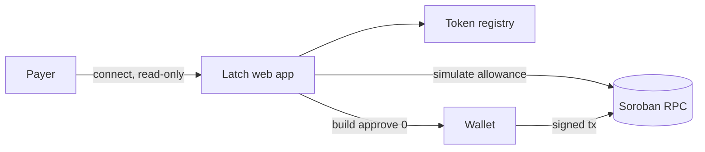

# Architecture

## The shape of it

One static bundle, one RPC endpoint, one wallet. No server of ours sits in the
path, which is the point: a tool whose job is to help you revoke trust should
not ask for much of it.

## The three hard parts

Everything else in this app is a table.

### 1. Discovery

There is no `getAllowancesForAccount`. Allowances live inside each token
contract's storage, keyed by `(from, spender)`, so reading one requires already
knowing which token and which spender to ask about. Latch composes three
imperfect sources into one candidate list, then probes each with a real
`allowance()` simulation and keeps the non-zero results. See
[`docs/adr/0001-discovery.md`](docs/adr/0001-discovery.md).

### 2. Ledger time

`expiration_ledger` is a ledger sequence number, not a timestamp. A user cannot
act on "expires at ledger 58,204,110". Converting it means reading the current
ledger, taking the average close interval (~5s), and projecting — which is an
estimate that drifts, and must be shown as one. See
[`docs/adr/0002-ledger-time.md`](docs/adr/0002-ledger-time.md).

### 3. Remaining vs. granted

`allowance()` returns what is *left*, not what was approved. "98 USDC
remaining" is much less useful than "98 of 120 remaining — something has been
spending this". Recovering the original figure means finding the `approve`
event, which is only possible inside the RPC's event retention window. Latch
shows the granted amount when it can and omits it rather than guessing when it
cannot.

## Invariants

- **Latch never holds a key.** Every state-changing transaction is built
  unsigned and handed to the wallet. There is no code path that signs.
- **Reading is free and submits nothing.** Allowance reads are simulations.
  Opening Latch costs no fee and leaves no trace on-chain.
- **A displayed allowance was read live.** Nothing is cached across sessions
  and presented as current; a stale read is labelled or refetched.
- **Amounts are `bigint` stroops.** Formatting happens once, at render. No
  float arithmetic touches a balance.
- **Absence is stated, not implied.** Latch cannot prove an account has no
  other allowances — only that none were found among the contracts it checked.
  The UI says so.

That last one matters more than it sounds. A tool that implies "you have no
outstanding allowances" when it means "I didn't find any" is worse than no tool
at all.

## What is deliberately missing in v0.1

Historical spend per allowance, multi-account views, notifications, allowance
*granting* (Latch removes standing permission; it does not hand it out), and
any server-side component. Each is an open issue rather than a hidden gap.
